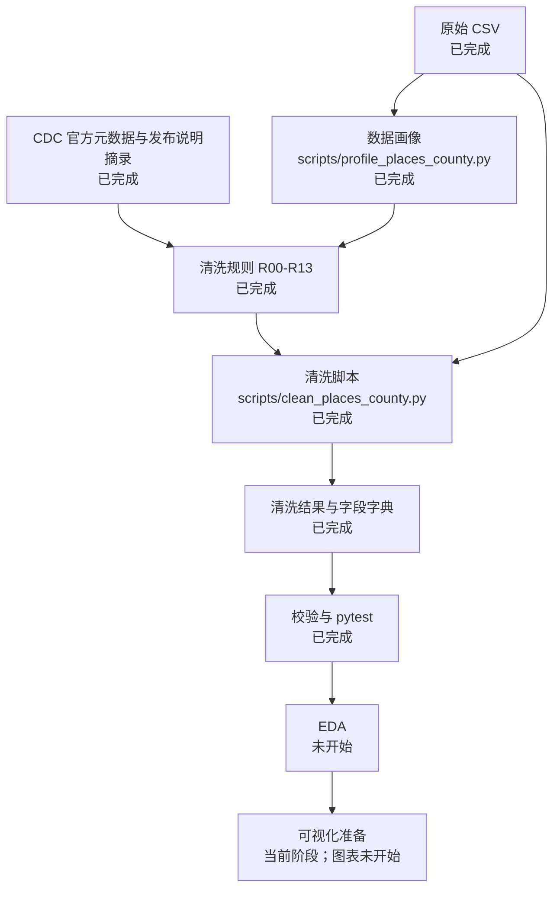

# SD6105 项目进度与 Pipeline

本文件根据 2026-10-22 工作区里的实际文件、脚本和日志写成。报告标识 `SD6105` 来自本次写作要求，仓库内没有另一份课程说明定义该编号。

检查时 Git 为 `main`，最新提交 `2582436`（`Adopt the uploaded local PLACES CSV as the cleaning source.`）。本文件只记录状态，不重新运行清洗，也不改数据、代码或已有日志。

事实分成三类：

- **已验证：** 能在当前文件、脚本或 `execution_log.jsonl` 中直接读到。
- **记录在案但未再核实：** 旧日志或旧 JSON 里有记录，后来的文件已经改口，或本报告没有重新执行该检查。
- **待办：** 仓库中尚不存在对应产物。

组员约定：后续只以本地 CSV 和 CDC 官方文档为标准，不再做额外数据对照核验。

## 1. 项目状态

### 目标

为 CDC PLACES 2025 县级 GIS 友好格式数据建立可重复的清洗结果，供之后的探索性分析（EDA）和可视化使用。数据集标识是 `i46a-9kgh`，名称是 `PLACES: County Data (GIS Friendly Format), 2025 release`。见 `reports/data_cleaning/run_20261022_185006/06_final_manifest.json`。

官方规则以这些已保存材料为准：

- `data/metadata/i46a-9kgh_view_metadata.json`
- `data/metadata/i46a-9kgh_columns.json`
- `data/reference/cdc_places_2025_release_notes_excerpt.txt`
- 字段说明中的测度定义；PLACES FAQ 的引用写在清洗报告中，不在本文件重复展开

本地数据文件名是 `PLACES__County_Data__GIS_Friendly_Format___2025_release.csv`。仓库中的持久副本是 `data/raw/places_county_gis_2025_i46a-9kgh.csv`。说明见 `data/raw/LOCAL_SOURCE.txt`。

### 已完成

- 原始 CSV、Socrata 视图元数据和列元数据已保存。
- 画像、清洗规则、清洗脚本、清洗结果、字段字典和校验结果已写入 `reports/data_cleaning/run_20261022_185006/`。
- 2026-10-22 19:36（亚洲/新加坡时间）用会话中上传的本地 CSV 又跑了一次清洗。日志记录源单元格改动为 0，清洗结果 SHA-256 与此前已校验文件相同。
- 自动化测试文件存在，已保存的 pytest 日志汇总为 4 passed。

### 当前阶段

清洗阶段已经结束。当前是 Data Visualization 准备阶段。仓库里仍然没有 EDA 脚本、图表、仪表板或演示文稿。本轮只更新状态和交接，没有重跑清洗，也没有改原始数据、清洗结果或清洗脚本。

### 已关闭事项

2026-10-22（亚洲/新加坡）按项目范围关闭下面三项。状态是 **Closed / Accepted**。这不是新的验证通过，也没有把未知原因改写成已查明。

| 事项 | 关闭前的记录 | 关闭决定 |
| --- | --- | --- |
| HRSN 11 个州空白（Q03） | 校验 V17 记录空白州为 CO、FL、KY、OR、PA、SD、TN、TX、VT、WA、WY。已保存的发布说明只写 39 个州和哥伦比亚特区，没有逐州点名。 | Closed / Accepted。不再追查官方逐州名单。可视化时把这 11 个州的七个 HRSN 指标当作未发布，不要画成 0。 |
| Loving County 缺失原因（Q08，校验 V26 为 WARNING） | FIPS `48301` 不在清洗文件中。成年人口是否低于 50 没有用人口表核实。 | Closed / Accepted。原因仍未知。不要补行，也不要把 V26 改成 PASS。 |
| V23 未测试 | `05_validation_results.csv` 中 V23 的状态仍是 `NOT TESTED`。 | Closed / Accepted。不再补做与 Windows 路径或上传文件的字节对照。V23 继续保持 NOT TESTED，不能写成 PASS。 |

目录签发日期 Q05 没有关闭成“已查明”。它仍只是使用限制：不要把数据标成 2023 年 7 月。数据行更新时间仍以元数据中的 2025-12-04 为准。

## 2. 完整 Pipeline



| 步骤 | 状态 | 依据 |
| --- | --- | --- |
| 原始 CSV | 已完成 | `data/raw/places_county_gis_2025_i46a-9kgh.csv` 存在 |
| 官方文档 | 已完成 | `data/metadata/` 与 `data/reference/cdc_places_2025_release_notes_excerpt.txt` 存在 |
| 数据画像 | 已完成 | `02_initial_profile.md` 与配套 CSV 存在；日志阶段 1–2，退出码 0 |
| 清洗规则 | 已完成 | `03_cleaning_specification.md`、`03_cleaning_rules.csv` |
| 清洗脚本 | 已完成 | `scripts/clean_places_county.py`；日志阶段 4 与阶段 8，退出码 0 |
| 清洗结果 | 已完成 | `data/processed/places_county_gis_2025_i46a-9kgh_cleaned.csv` |
| 验证 | 已完成 | `05_validation_results.csv`；`05_pytest_log.txt` 为 4 passed |
| EDA | 未开始 | 仓库中无 EDA 脚本或笔记本 |
| 可视化准备 | 当前阶段 | 本节与交接文档已写明可用字段和限制；尚无图表 |
| 图表或仪表板 | 未开始 | 仓库中无图表或仪表板 |

## 3. 技术记录

### 数据路径

| 用途 | 路径 |
| --- | --- |
| 本地源文件名 | `PLACES__County_Data__GIS_Friendly_Format___2025_release.csv`（见 `data/raw/LOCAL_SOURCE.txt`） |
| 仓库中的原始 CSV | `data/raw/places_county_gis_2025_i46a-9kgh.csv` |
| 原始 SHA-256 | `a47cad3a852c5b35a031d548bc6dd4e9b5f7836bb7c851b84382160beafe15ef`（`data/metadata/raw_sha256.txt`） |
| 视图元数据 | `data/metadata/i46a-9kgh_view_metadata.json` |
| 列元数据 | `data/metadata/i46a-9kgh_columns.json` |
| 清洗结果 | `data/processed/places_county_gis_2025_i46a-9kgh_cleaned.csv` |
| 清洗结果 SHA-256 | `58a324b2918d1e6571056235afc4f1d8fd2817e00c09f1833355de515fadf201` |
| 字段字典 | `data/processed/places_county_gis_2025_field_dictionary.csv` |
| 发布说明摘录 | `data/reference/cdc_places_2025_release_notes_excerpt.txt` |
| 县名对照（已有参考，不再扩展核验） | `data/reference/places_to_2023_gazetteer.csv` |

原始文件 4,808,551 字节。清洗结果 7,187,414 字节。这两个字节数来自 `05_cleaned_integrity.json`。该 JSON 里的校验计数仍是较早的 22 PASS / 3 NOT TESTED，晚于它的 `05_validation_results.csv` 和 `06_final_manifest.json` 才是 24 PASS / 1 WARNING / 1 NOT TESTED。使用校验计数时以 CSV 和 manifest 为准。

### 脚本

| 文件 | 作用 |
| --- | --- |
| `scripts/places_common.py` | 路径、州 FIPS 表、区间与坐标正则、读写与日志 |
| `scripts/profile_places_county.py` | 只读画像 |
| `scripts/clean_places_county.py` | 清洗 |
| `scripts/validate_places_county.py` | 独立校验 |
| `tests/test_places_cleaning.py` | pytest |

重跑清洗：

```bash
PYTHONPATH=scripts python3 scripts/clean_places_county.py \
  --raw data/raw/places_county_gis_2025_i46a-9kgh.csv \
  --output data/processed/places_county_gis_2025_i46a-9kgh_cleaned.csv
```

环境记录在 `reports/data_cleaning/run_20261022_185006/environment.txt`：Python 3.12.3，pytest 9.1.1。清洗使用标准库 `csv`，不用 pandas，以免 `CountyFIPS` 被转成整数并丢掉前导零。`requirements.txt` 只列出 `pytest==9.1.1`。

### 已执行的清洗规则

来源：`04_transformation_summary.json` 与 `03_cleaning_rules.csv`。

采纳：R00、R01、R02、R04、R05、R06、R09、R10、R11、R12、R13。

拒绝：R03（不改 `FOODSTAMP_Crude95ci` 的大小写）、R07（不删极端值）、R08（不按县名去重）。

结果计数：

- 源单元格改动：0
- 删除行、删除列、插补：均为 0
- 置信区间解析成功：229,152；空白保留：22,288；解析失败：0
- 中心点解析：3,143
- 同州短名冲突行：12
- 显示名修正：1，仅 FIPS `35013` 的 `derived__CountyName_display` 为 Doña Ana；源列 `CountyName` 保持原令牌

CDC 规则在清洗中的用法：发布说明摘录写明肯塔基和宾夕法尼亚没有 2023 BRFSS 指标，五个 2022 指标被保留。空白因此保留，不填 0。患病率按百分比理解。成年人口少于 50 的地理单元不报告估计；本文件中 Kalawao 的 `TotalPop18plus` 为 75，且保险估计非空（校验 V18）。

### 验证结果与日志

最新校验文件：`reports/data_cleaning/run_20261022_185006/05_validation_results.csv`。

- PASS：V01–V22、V24、V25，共 24 项
- WARNING：V26，Loving County 不在文件中。原因未查明。该调查已 Closed / Accepted，校验状态仍是 WARNING，不是 PASS。
- NOT TESTED：V23。校验文件里的文字仍是 NOT TESTED。该调查已 Closed / Accepted，没有改成 PASS。
- FAIL：无

`05_pytest_log.txt` 只有汇总：`4 passed in 2.94s`。它没有逐条列出测试名。测试模块中定义了四个函数：`test_validation_suite_has_no_failures`、`test_cleaner_refuses_a_different_raw_file`、`test_display_repair_does_not_guess_other_non_ascii_names`、`test_repeat_clean_of_preserved_file_is_stable`。日志阶段 7 的计数也写了 `pytest: 4`。不能从日志文本单独推出每个函数的单独结果，只能确认这次保存的运行是 4 passed。

日志路径：`reports/data_cleaning/run_20261022_185006/execution_log.jsonl`。

该日志按写入顺序追加，不是按阶段号排序。时间均为日志中的 `timestamp_sgt`。

| 顺序 | 亚洲/新加坡时间 | phase_id | action | exit_status |
| --- | --- | --- | --- | --- |
| 1 | 2026-10-22T18:58:11 | 1-2 | profile_raw_county_csv | 0 |
| 2 | 2026-10-22T19:00:22 | 1-2 | profile_raw_county_csv | 0 |
| 3 | 2026-10-22T19:04:04 | 1-2 | profile_raw_county_csv | 0 |
| 4 | 2026-10-22T19:04:05 | 4 | clean_places_county | 0 |
| 5 | 2026-10-22T19:04:06 | 5 | validate_cleaned_county_file | 0（当时 22 PASS，3 NOT TESTED） |
| 6 | 2026-10-22T19:08:05 | 0 | write_workspace_audit_and_plan | 0 |
| 7 | 2026-10-22T19:08:05 | 3 | write_cleaning_specification | 0 |
| 8 | 2026-10-22T19:08:05 | 6 | write_final_handoff | 0 |
| 9 | 2026-10-22T19:31:12 | 5 | validate_cleaned_county_file | 0（24 PASS，1 WARNING，1 NOT TESTED） |
| 10 | 2026-10-22T19:31:25 | 7 | resume_gazetteer_and_release_notes | 0 |
| 11 | 2026-10-22T19:36:45 | 4 | clean_places_county（输入为会话上传文件） | 0 |
| 12 | 2026-10-22T19:36:46 | 8 | adopt_uploaded_local_csv | 0 |

第 11 与第 12 条记录的清洗结果哈希与第 9 条校验时的哈希相同。第 11 条之后没有新的校验日志。因此“上传文件被采纳后又完整重跑了 V01–V26”不是已验证事实。

## 4. 数据与质量状态

### 行列与字段

| 文件 | 行 | 列 | 来源 |
| --- | ---: | ---: | --- |
| 原始 CSV | 3,143 | 167 | `04_transformation_summary.json`；校验 V02/V03 对清洗文件读到 3,143 × 332 |
| 清洗 CSV | 3,143 | 332 | 同上。332 = 167 个源列 + 165 个 `derived__` 列 |

源列全部保留，顺序不变，包括 `FOODSTAMP_Crude95ci`（V04、V06：0 个源单元格不一致）。没有删除行或列，没有插补。

派生列是：`derived__source_row_number`、`derived__CountyName_display`、`derived__short_name_collision`、`derived__Geolocation_Longitude`、`derived__Geolocation_Latitude`，以及每个置信区间字段的 Low/High。字段含义在 `data/processed/places_county_gis_2025_field_dictionary.csv`。

### 校验通过、警告、未测试

见上一节。失败数为 0。

通过项覆盖：原始哈希、文件可重开、行列、源列完整且未改、FIPS 为五位文本且 318 个仍带前导零、州名与州代码一致、12 行短名冲突被标记而非删除、Doña Ana 只改显示列、区间可解析且估计落在区间内、人口为正整数且 18 岁以上人口不超过总人口、坐标可解析、肯塔基和宾夕法尼亚的 2023 指标为空白而 2022 指标存在、HRSN 在同一 11 州为空白、Kalawao 被保留、重复清洗哈希一致、Socrata 计算列未被造出。

HRSN 空白州，来自 V17 的记录：CO、FL、KY、OR、PA、SD、TN、TX、VT、WA、WY。

### 已知限制

下一阶段必须保留：

- 估计是模型小域估计，不是直接调查百分比。不要只用点估计给县排名。
- 粗率与年龄调整是不同列，不能合并。
- 五个 2022 指标与其余 2023 指标不是同一调查年。五个指标是：结直肠癌筛查、乳腺 X 线、睡眠不足、牙科就诊、全部牙齿脱落。见发布说明摘录。
- 空白不是 0。肯塔基和宾夕法尼亚不要画 2023 指标。上面 11 个州不要画七个 HRSN 指标。
- 用 `CountyFIPS` 连接地图。县名在州内可以重复。`derived__short_name_collision = yes` 的是这 12 个 FIPS：`24005`、`24510`、`29189`、`29510`、`51059`、`51067`、`51159`、`51161`、`51600`、`51620`、`51760`、`51770`。
- 标签用 `derived__CountyName_display`。它只在 FIPS `35013` 与源列不同。
- 不要把患病率乘以 `TotalPopulation`，除非分母就是该指标对应的人群。患病率是百分比。
- 康涅狄格使用的是规划区代码 `09110`–`09190`，不是旧的八个县代码。这来自发布说明摘录和文件中的代码，不是本次新做的对照。
- Loving County（`48301`）没有行。不要补造。
- `derived__source_row_number` 只是原始文件行号，不是地理编码。
- 部分患病率记号没有小数（例如 `35`），部分有一位小数。按发布记号使用，没有统一补 `.0`。

## 5. 下一步交接

清洗阶段结束。下一阶段是 Data Visualization 准备，然后才是作图。不要回到清洗脚本。

### 现在可用

- 清洗表：`data/processed/places_county_gis_2025_i46a-9kgh_cleaned.csv`
- 字段字典：`data/processed/places_county_gis_2025_field_dictionary.csv`（332 行字段说明，与清洗表列数一致）
- 原始表：`data/raw/places_county_gis_2025_i46a-9kgh.csv`
- 清洗交接：`reports/data_cleaning/run_20261022_185006/06_cleaning_handoff.md`
- 本进度报告：`reports/project_status/SD6105_project_status_and_pipeline.md`

本环境不能写入 `C:\Users\ASUS\Desktop\Data Visualization`。给组员的副本就是上面这一份仓库文件。

### 仍须遵守的使用限制

- Q03、Q08、V23 已按范围关闭，事实没有升级。HRSN 仍按 V17 的 11 州处理；Loving County 仍没有行；V23 仍是 NOT TESTED。
- Q05 未关闭为已查明：不要把数据标成 2023 年 7 月。
- 空白不是 0。肯塔基和宾夕法尼亚不要画 2023 指标。
- 地图键用 `CountyFIPS`。区间用 `derived__*_Low` 和 `derived__*_High`。

### 建议的入口

读第 6 节的字段和方向，从清洗表选图，而不是从原始 CSV 重做清洗。第一张图不要包含肯塔基、宾夕法尼亚的 2023 指标，也不要把 HRSN 画进上述 11 个空白州。

## 6. Data Visualization 准备

字段来自 `data/processed/places_county_gis_2025_field_dictionary.csv`。字典有 332 行，对应清洗表的 332 列。其中 40 个指标各有粗率、粗率区间、年龄调整、年龄调整区间四列。

### 地理字段

| 字段 | 用途 |
| --- | --- |
| `CountyFIPS` | 地图和连接的主键，五位文本 |
| `StateAbbr`、`StateDesc` | 州筛选 |
| `CountyName` | 源短名 |
| `derived__CountyName_display` | 标注。只在 FIPS `35013` 修成 Doña Ana |
| `derived__short_name_collision` | `yes` 表示同州另有一个同名县或县等价区 |
| `Geolocation` | 源 WKT 中心点 |
| `derived__Geolocation_Longitude`、`derived__Geolocation_Latitude` | 从 WKT 取出的经纬度文本 |
| `TotalPopulation`、`TotalPop18plus` | 2023 年人口计数，不是每个指标的分母 |

`derived__source_row_number` 只用于回到原始行，不用于地图。

### 核心指标

40 个指标前缀。作图时用 `前缀_CrudePrev` 或 `前缀_AdjPrev`，不要混在同一条序列里。年份写在字段字典的描述里。

| 类别 | 个数 | 前缀 |
| --- | ---: | --- |
| 健康结果 | 12 | ARTHRITIS，BPHIGH，CANCER，CASTHMA，CHD，COPD，DEPRESSION，DIABETES，HIGHCHOL，OBESITY，STROKE，TEETHLOST |
| 预防 | 7 | ACCESS2，BPMED，CHECKUP，CHOLSCREEN，COLON_SCREEN，DENTAL，MAMMOUSE |
| 健康风险行为 | 4 | BINGE，CSMOKING，LPA，SLEEP |
| 残疾 | 7 | HEARING，VISION，COGNITION，MOBILITY，SELFCARE，INDEPLIVE，DISABILITY |
| 健康状况 | 3 | GHLTH，MHLTH，PHLTH |
| 健康相关社会需求 | 7 | LONELINESS，FOODSTAMP，FOODINSECU，HOUSINSECU，SHUTUTILITY，LACKTRPT，EMOTIONSPT |

适合先做的核心图，仍然只用现有字段：

- 一张全国县地图：`OBESITY_AdjPrev` 或 `DIABETES_AdjPrev`，配合同名 Low/High。这两个描述是 2023、成年人，空白只涉及肯塔基和宾夕法尼亚。
- 一张 2022 指标地图：`DENTAL_CrudePrev` 或 `SLEEP_CrudePrev`。发布说明写明这两项在肯塔基和宾夕法尼亚被保留，校验 V16 记录 DENTAL 没有整州空白。
- 不要把 `COLON_SCREEN`（45–75 岁）、`MAMMOUSE`（50–74 岁女性）、`TEETHLOST`（65 岁及以上）、`ACCESS2`（18–64 岁）与全体成年人指标画成同一人口。
- HRSN 只在非空白州使用。字段字典里 `LONELINESS_CrudePrev` 的描述仍写 “feeling socially isolated”；列名是 LONELINESS。发布说明摘录说该测度已从社会隔离改为孤独。作图标题用列名和发布说明中的 loneliness，不要另造一个新指标。

### 置信区间字段

- 源区间 80 列：每个指标的 `*_Crude95CI` 与 `*_Adj95CI`。`FOODSTAMP_Crude95ci` 的 `ci` 是小写，这是源列名。
- 派生区间 160 列：每个源区间对应 `derived__原列名_Low` 和 `derived__原列名_High`。
- 源区间是文本，例如带空格的 `(low, high)`。作图用派生的 Low/High。空白区间的派生列也是空白，不是 0。

### 适合的方向

1. 县 choropleth：年龄调整患病率，颜色表示点估计，另外用区间宽度或 Low/High 表示不确定度。
2. 州内分布：箱线或点图，比较各县的同一指标，并标出肯塔基、宾夕法尼亚缺失。
3. 粗率与年龄调整并排，同一指标两列，不取平均。
4. HRSN 小倍数图，事先去掉 11 个空白州，避免大片假缺失被读成低患病率。

不做的事：不制作图表或仪表板，不把县按一个点估计排成健康排名，不把 2022 与 2023 指标连成时间趋势。
